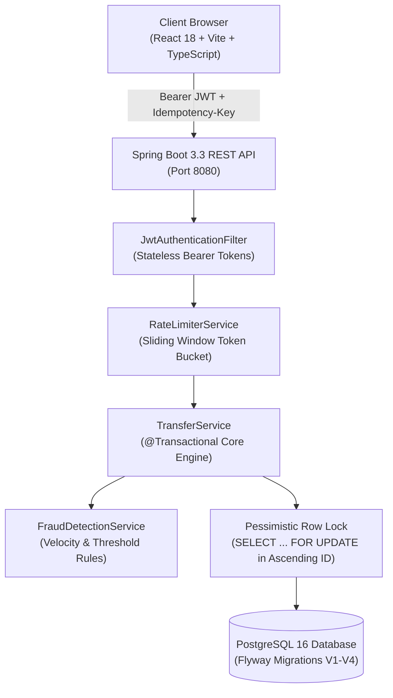
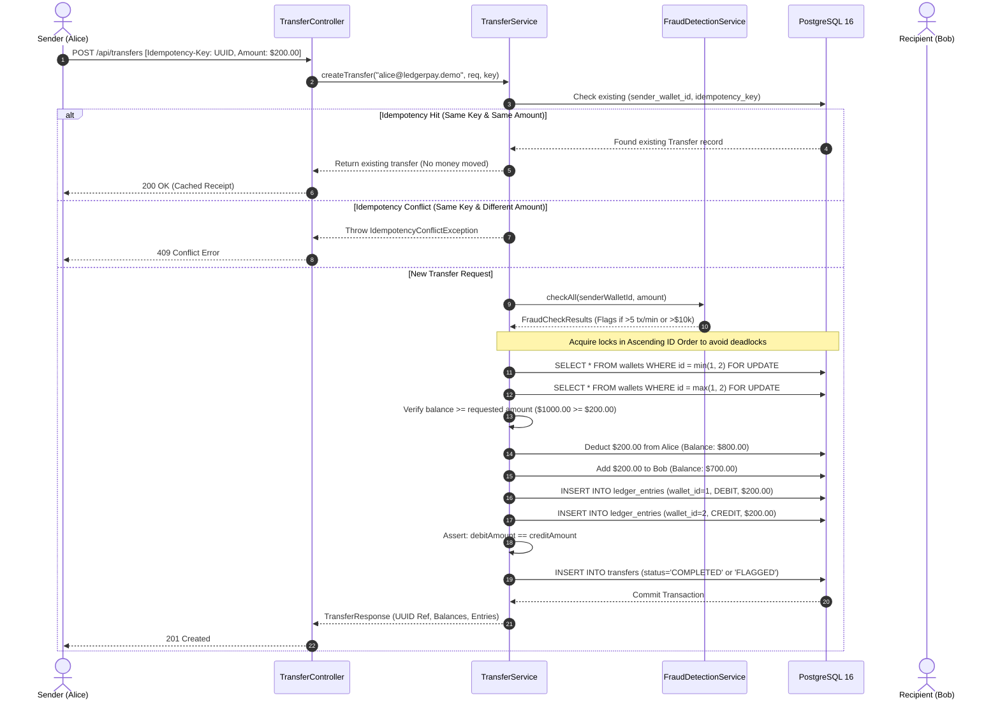
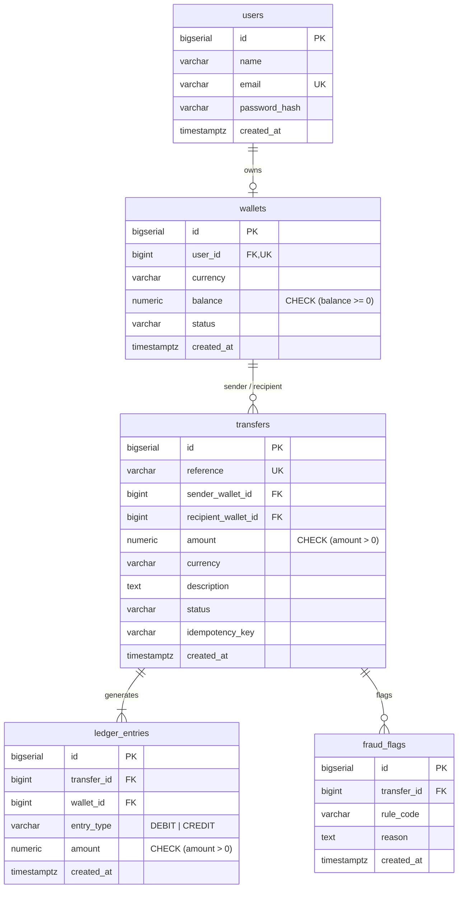

# LedgerPay — Secure Payment & Wallet Management System

> **A portfolio-grade fintech wallet management platform and double-entry payment ledger engine built with Java 17 / Spring Boot 3, PostgreSQL, Flyway, React, and TypeScript.**

[](https://openjdk.org/)
[](https://spring.io/projects/spring-boot)
[](https://www.postgresql.org/)
[](https://react.dev/)
[](https://www.typescriptlang.org/)
[](https://tailwindcss.com/)
[](f:/Aastha/Ledgerpay/backend)

---

## 1. Executive Summary & Product Vision

**LedgerPay** is an enterprise-grade payment and wallet management platform inspired by the core settlement infrastructure of global card networks and financial institutions (such as Visa Direct and Stripe Ledger).

Traditional fintech tutorials and amateur projects update wallet balances with arbitrary SQL updates (`UPDATE wallets SET balance = balance - 100`). In real-world payment infrastructure, balance updates are **cached aggregates derived from an immutable double-entry ledger**. Every fund movement must be atomic, idempotent, auditable, and mathematically balanced across debit and credit entries.

### Key Capabilities

- **Atomic Inter-Wallet Settlements**: Transfers execute inside an isolated `@Transactional` database boundary with pessimistic row locking.
- **Strict Double-Entry Bookkeeping**: Every completed transfer generates exactly one `DEBIT` entry and one `CREDIT` entry. An assertion verifies $\sum \text{Debits} \equiv \sum \text{Credits}$ before committing.
- **Deterministic Concurrency & Deadlock Prevention**: Row locks are acquired in ascending ID order (`min(id), max(id)`), completely eliminating database deadlock cycles between bidirectional concurrent transfers.
- **Database-Level Idempotency**: Client-supplied `Idempotency-Key` headers are uniquely constrained at the database layer per sender wallet, ensuring repeated calls return identical results without double-spending.
- **Rule-Based Fraud Detection**: Real-time evaluation of velocity spikes (>5 transfers/min), large value transfers (>$10,000 threshold), and repeated failures.
- **Sliding-Window Rate Limiting**: In-memory rate limiting (60 req/min) returning HTTP 429 upon quota exhaustion.
- **Enterprise Design Direction**: A restrained corporate aesthetic using a disciplined palette (Navy `#172B4D`, Slate `#344563`, Cool Gray `#F4F6F8`, Muted Green `#218568`, Amber `#B7791F`, Crimson `#C2414B`), compact high-density data tables, and zero decorative fluff.

---

## 2. Architecture Overview

### High-Level System Architecture



### End-to-End Transfer Settlement Sequence



---

## 3. Core Financial Engineering Decisions

### 3.1. Why Double-Entry Bookkeeping?

In standard single-entry ledgers, an account balance is simply a number in a database column. If a software bug, concurrent collision, or hardware failure occurs during an update, money can literally vanish or be created out of thin air with no audit trail.

LedgerPay strictly enforces **Double-Entry Bookkeeping**:
1. Every economic transaction involves two or more accounts.
2. For every transfer, the total amount debited must equal the total amount credited:
   $$\sum \text{Debits} = \sum \text{Credits}$$
3. The table `ledger_entries` is **immutable**: rows are append-only. No `UPDATE` or `DELETE` statements are ever executed against the ledger.
4. An explicit code assertion in [`TransferService.java`](f:/Aastha/Ledgerpay/backend/src/main/java/com/ledgerpay/service/TransferService.java#L190-L196) verifies that the debit amount equals the credit amount before allowing the transaction to commit.

### 3.2. Concurrency Control & Deadlock Prevention

Consider a scenario where:
- Thread 1 processes Alice transferring \$50 to Bob (needs write locks on Wallet 1 and Wallet 2).
- Simultaneously, Thread 2 processes Bob transferring \$30 to Alice (needs write locks on Wallet 2 and Wallet 1).

If Thread 1 locks Wallet 1 first, while Thread 2 locks Wallet 2 first, a classic **deadlock** occurs in the database engine.

**LedgerPay's Solution:**
LedgerPay implements **Deterministic Ascending Row-Lock Acquisition**:

```java
Long lowId  = Math.min(senderWalletRef.getId(), recipientWalletRef.getId());
Long highId = Math.max(senderWalletRef.getId(), recipientWalletRef.getId());

// Always lock the lower ID first, regardless of transfer direction
Wallet lowWallet  = walletRepository.findByIdWithLock(lowId);
Wallet highWallet = walletRepository.findByIdWithLock(highId);
```

Because all transactions lock resources in identical numerical order, cyclic lock-wait graphs cannot form. Concurrency is safe and race conditions attempting to overspend the same wallet balance are fully serialized.

### 3.3. Database-Enforced Idempotency

Network timeouts and client retry loops frequently duplicate requests. LedgerPay requires clients to submit an `Idempotency-Key` header (typically a client-generated UUID v4) with every transfer.

1. **Database Constraint**: A unique partial index enforces uniqueness:
   ```sql
   CREATE UNIQUE INDEX idx_transfers_idempotency 
   ON transfers(sender_wallet_id, idempotency_key) 
   WHERE idempotency_key IS NOT NULL;
   ```
2. **Replay Protection**: If the same key is submitted with the **same transfer parameters**, LedgerPay immediately returns the original completed transfer receipt without re-executing money movement.
3. **Conflict Detection**: If the same key is reused with **different parameters** (e.g. attempting to send \$500 instead of \$200), LedgerPay rejects the request with HTTP `409 Conflict`.

### 3.4. Numeric Precision

All monetary calculations use PostgreSQL `NUMERIC(19, 4)` and Java `java.math.BigDecimal`. Floating-point types (`float`, `double`, and JavaScript binary floating point) are strictly banned from financial logic to eliminate IEEE-754 precision drift.

---

## 4. Database Schema & Migration Strategy

Database migrations are managed using **Flyway**:

```
backend/src/main/resources/db/migration/
├── V1__create_users_wallets.sql     # Users and Wallets with CHECK constraints
├── V2__create_transfers_ledger.sql  # Transfers, Idempotency Index, Ledger Entries
├── V3__create_fraud_flags.sql       # Fraud Flag records
└── V4__seed_demo_data.sql           # 5 Demo accounts & 15 balanced transfers
```

### Relational Schema Diagram



---

## 5. REST API Documentation

### Base URL: `http://localhost:8080/api`

| Endpoint | Method | Auth | Description |
|---|---|---|---|
| `/auth/login` | `POST` | Public | Authenticates user; returns JWT token & user info |
| `/auth/me` | `GET` | User | Validates token and returns current session details |
| `/wallet` | `GET` | User | Retrieves current user's wallet balance and status |
| `/wallet/transactions` | `GET` | User | Searchable, paginated transaction history |
| `/transfers` | `POST` | User | Executes an atomic money transfer (Supports `Idempotency-Key`) |
| `/transfers` | `GET` | User | Paginated list of transfers involving the current user |
| `/transfers/{id}` | `GET` | User | Single transfer details with associated ledger entries |
| `/ledger/entries` | `GET` | User | Paginated immutable ledger entries for user's wallet |
| `/ledger/entries/{id}` | `GET` | User | Inspect a specific ledger entry |
| `/ledger/summary` | `GET` | User | Aggregate debit/credit totals and entry counts |

### Sample Request: Execute Transfer

```http
POST /api/transfers HTTP/1.1
Host: localhost:8080
Authorization: Bearer <JWT_TOKEN>
Idempotency-Key: 9f12d5e2-45e6-42d4-a82f-2c7c5d31cb01
Content-Type: application/json

{
  "recipientEmail": "bob@ledgerpay.demo",
  "amount": 250.00,
  "description": "Consulting retainer payment"
}
```

### Sample Response (201 Created)

```json
{
  "id": 16,
  "reference": "6f2e82f1-2856-4c48-b4b1-8408f65eb56e",
  "senderEmail": "alice@ledgerpay.demo",
  "recipientEmail": "bob@ledgerpay.demo",
  "amount": 250.0000,
  "currency": "USD",
  "description": "Consulting retainer payment",
  "status": "COMPLETED",
  "fraudFlags": [],
  "ledgerEntries": [
    {
      "id": 31,
      "transferReference": "6f2e82f1-2856-4c48-b4b1-8408f65eb56e",
      "walletOwnerName": "Alice Chen",
      "entryType": "DEBIT",
      "amount": 250.0000,
      "currency": "USD",
      "createdAt": "2026-10-24T10:48:40.118+05:30"
    },
    {
      "id": 32,
      "transferReference": "6f2e82f1-2856-4c48-b4b1-8408f65eb56e",
      "walletOwnerName": "Bob Martinez",
      "entryType": "CREDIT",
      "amount": 250.0000,
      "currency": "USD",
      "createdAt": "2026-10-24T10:48:40.118+05:30"
    }
  ],
  "createdAt": "2026-10-24T10:48:40.115+05:30"
}
```

---

## 6. Demo Accounts (Local Sandbox)

The database migration seeds 5 demo accounts with pre-calculated, balanced transfer histories. The default password for all demo accounts is **`demo1234`**.

| Name | Email | Initial Balance | Role |
|---|---|---|---|
| **Alice Chen** | `alice@ledgerpay.demo` | \$12,500.00 | Primary Demo Account |
| **Bob Martinez** | `bob@ledgerpay.demo` | \$3,200.00 | Counterparty Account |
| **Carol Singh** | `carol@ledgerpay.demo` | \$8,750.00 | Enterprise Merchant |
| **David Kim** | `david@ledgerpay.demo` | \$500.00 | Low-Balance Account (Overdraft testing) |
| **Eve Thompson** | `eve@ledgerpay.demo` | \$15,000.00 | High-Volume Account |

---

## 7. Automated Testing Suite

The backend includes a comprehensive automated test suite verifying financial edge cases, idempotency guarantees, concurrency edge cases, and fraud detection.

### Test Execution Summary (17 Tests Passed)

```text
[INFO] -------------------------------------------------------
[INFO]  T E S T S
[INFO] -------------------------------------------------------
[INFO] Running com.ledgerpay.controller.AuthControllerTest
[INFO] Tests run: 3, Failures: 0, Errors: 0, Skipped: 0 (AuthControllerTest)
[INFO] Running com.ledgerpay.service.FraudDetectionServiceTest
[INFO] Tests run: 6, Failures: 0, Errors: 0, Skipped: 0 (FraudDetectionServiceTest)
[INFO] Running com.ledgerpay.service.TransferServiceTest
[INFO] Tests run: 8, Failures: 0, Errors: 0, Skipped: 0 (TransferServiceTest)
[INFO] 
[INFO] Results:
[INFO] Tests run: 17, Failures: 0, Errors: 0, Skipped: 0
[INFO] BUILD SUCCESS
```

### Critical Scenarios Verified

- [x] **`successfulTransfer_updatesBothBalances_createsLedgerEntries`**: Validates that both balances update and exactly two ledger records (`DEBIT` and `CREDIT`) are generated with equal values.
- [x] **`insufficientFunds_throwsException_noBalanceChange`**: Asserts that an overdraft attempt throws `InsufficientFundsException` and aborts before ledger generation.
- [x] **`sameWallet_throwsTransferValidationException`**: Prevents users from transferring funds to their own wallet.
- [x] **`nonExistentRecipient_throwsResourceNotFoundException`**: Verifies handling of invalid counterparty accounts.
- [x] **`negativeAmount_throwsValidationException`**: Rejects negative or zero amount transfers.
- [x] **`duplicateIdempotencyKey_returnsSameResult`**: Ensures re-submitting an identical transfer returns the original result without moving money a second time.
- [x] **`differentRequestSameKey_throwsIdempotencyConflictException`**: Rejects reuse of an idempotency key with conflicting transfer parameters.
- [x] **`fraudRuleTriggered_setsTransferFlaggedStatus`**: Flags transfers exceeding velocity or threshold limits while preserving ledger records.
- [x] **`rateLimit_triggers_afterFiveTransfersInOneMinute`**: Verifies velocity fraud checks.
- [x] **`largeTransfer_triggers_aboveThreshold`**: Flags transfers greater than \$10,000.

To execute tests locally:
```bash
cd backend
mvn test
```

---

## 8. Local Setup Instructions (Windows)

### Prerequisites

- **Java Development Kit (JDK 17 or 21)**
- **Apache Maven 3.8+**
- **Node.js (v18+) & npm**
- **Docker Desktop** (or a local PostgreSQL 15+ installation)

---

### Step 1: Start PostgreSQL

From the project root:
```powershell
docker compose up -d
```

Verify PostgreSQL is running on port `5432`:
```powershell
docker ps
```

---

### Step 2: Configure Environment Variables

Copy `.env.example` to `.env`:
```powershell
cp .env.example .env
```

Default credentials:
```properties
DB_URL=jdbc:postgresql://localhost:5432/ledgerpay
DB_USERNAME=ledgerpay
DB_PASSWORD=ledgerpay_secret
JWT_SECRET=your-256-bit-secret-key-for-ledgerpay-dev-only-change-in-prod
```

---

### Step 3: Run the Spring Boot Backend

```powershell
cd f:\Aastha\Ledgerpay\backend
mvn spring-boot:run
```

*Flyway will automatically apply migrations `V1` through `V4`, initializing all tables and demo accounts.*

Backend health check:
```powershell
curl http://localhost:8080/actuator/health
# {"status":"UP"}
```

---

### Step 4: Run the React Frontend

Open a second terminal window:
```powershell
cd f:\Aastha\Ledgerpay\frontend
npm run dev
```

Navigate to `http://localhost:5173` in your browser. Click **"Alice Chen"** on the sign-in screen to instantly log into the demo sandbox!

---

## 9. Known Limitations & Production Roadmap

1. **Distributed Locks**: In a horizontally autoscaled microservices architecture spanning multiple database clusters or regions, row-level database locking can be augmented with a distributed locking protocol (e.g. Redlock or Two-Phase Commit).
2. **Multi-Currency FX Ledger**: The current implementation standardizes on USD. A production multi-currency system requires an FX exchange-rate service with unrealized gain/loss ledger balancing accounts.
3. **Outbox Pattern & Event Streaming**: For asynchronous notification downstream (e.g., fraud analyst webhooks or mobile push notifications), a Transactional Outbox table publishing events to Kafka would decouple write paths from asynchronous event consumers.
4. **Hardware Security Modules (HSM)**: In payment card production environments (PCI-DSS compliance), symmetric keys and token signatures are protected by FIPS 140-2 Level 3 HSM appliances.
